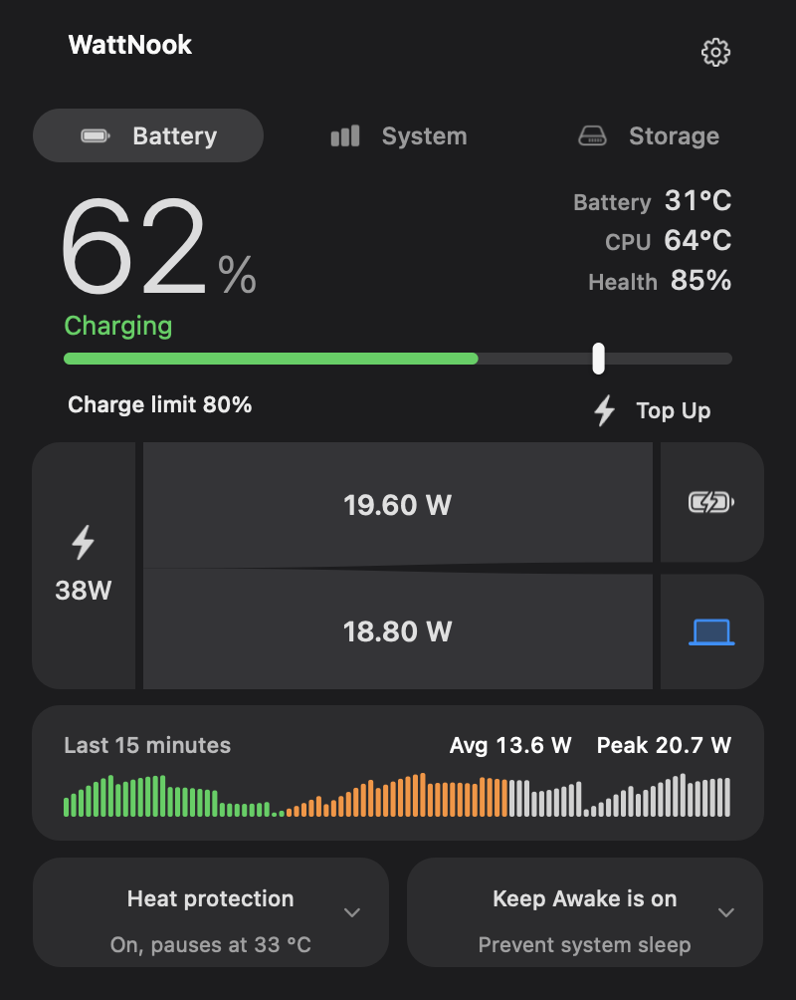
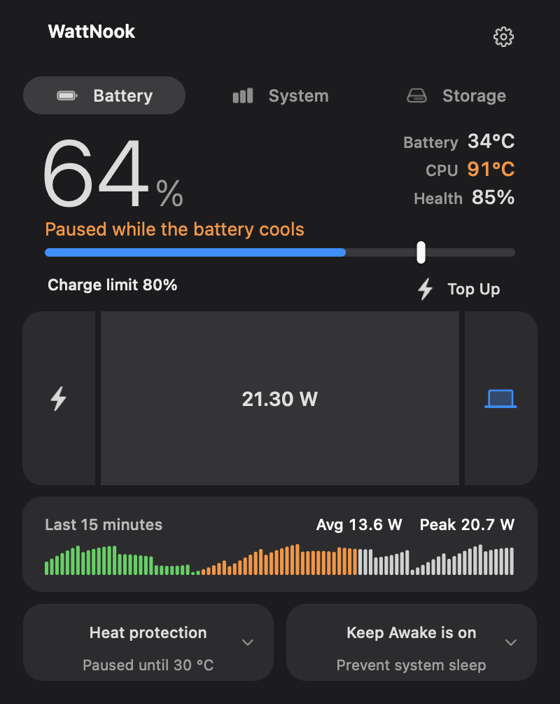
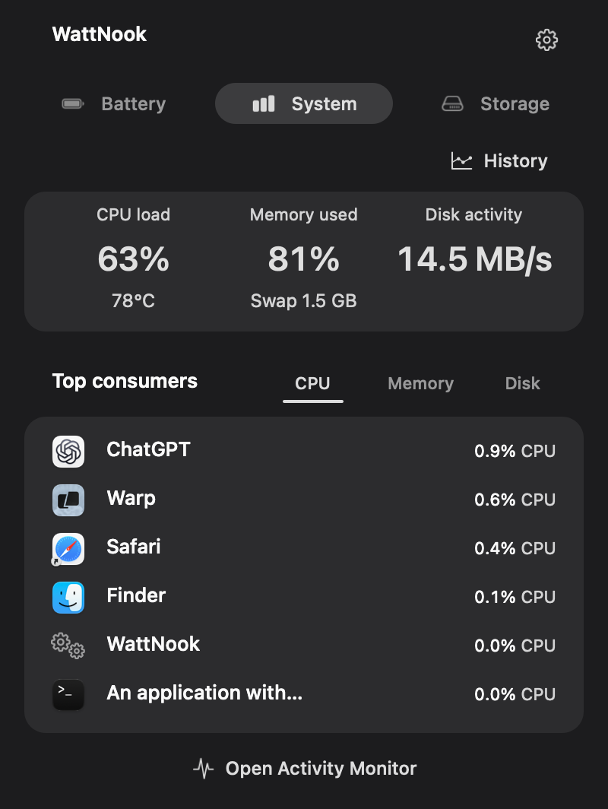
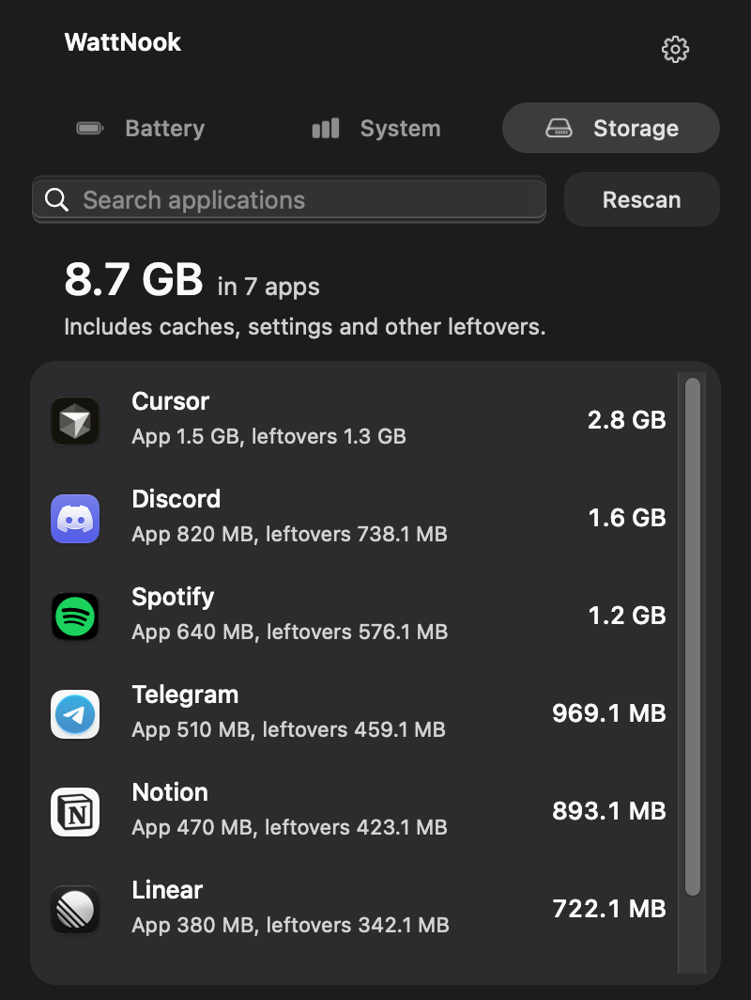
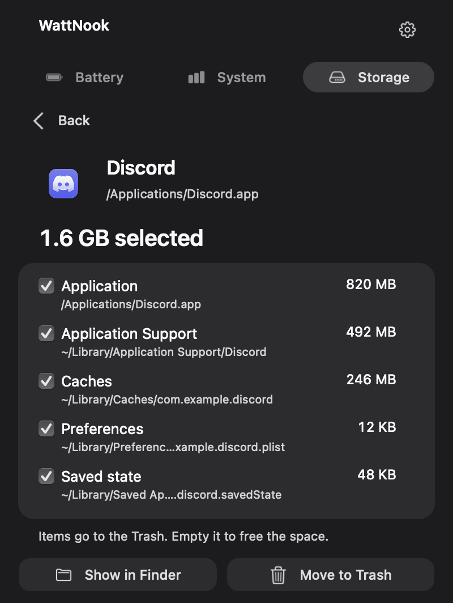

<p align="center">
  
</p>

<h1 align="center">WattNook</h1>

<p align="center"><strong>Free battery care for Apple Silicon Macs — and it works on macOS 27.</strong><br>
Heat Protection, charge limits from 50%, a live view of where every watt goes, your AI limits in the menu bar, and an app uninstaller.</p>

<p align="center">
  <a href="https://github.com/itscloud0/wattnook/releases/latest"></a>
  <a href="LICENSE"></a>
  
  
  
  
</p>

<p align="center">
  
</p>

<p align="center">
  
</p>

<p align="center"><a href="https://github.com/itscloud0/wattnook/releases/latest"><strong>Download the latest release →</strong></a></p>

## Why WattNook

macOS 27 removed the SMC keys that charge limiters relied on, so most of them quietly stopped working. WattNook drives charging through the same top-off-protection path macOS uses itself, and verifies the result on real hardware.

- **Heat Protection that keeps you on AC.** When the battery gets hot, charging pauses at the current level while the adapter keeps powering the Mac. It resumes once the battery cools. A low battery whose adapter can't keep up is never left draining.
- **Charge limits from 50% to 100%.** Apple's built-in setting stops at 80%. WattNook adds 50–75%, never discharges on the adapter to reach a lower limit, and keeps Apple's 80% underneath as a safety net.
- **Sailing, Top Up and Discharge, free.** Sailing stops micro-charging: once the limit is reached the battery drifts 5–10% before charging again. Top Up charges to 100% once for a trip and restores your limit when you unplug. Discharge runs down to a lower limit while the charger stays plugged in.
- **See where the power goes.** A live power flow shows the adapter's watts splitting between the Mac and the battery (or the battery helping a weak charger), a 15-minute strip of Mac power, battery *and* CPU temperature, and battery health.
- **Your AI limits at a glance.** The menu bar can rotate from CPU and RAM to how much of your Claude, ChatGPT and Grok 5-hour and weekly limits is left. Pick the services and their order; every page keeps one grid, so nothing in the menu bar shifts. WattNook reads the logins Claude Code and Codex already keep only to ask Anthropic and OpenAI for your usage, and reads Grok Bot's own cached reading; it never refreshes, copies or stores them.
- **A menu bar that looks like macOS.** On macOS 27 the battery is drawn from Control Center's own geometry, with the charge inside it.
- **Find what's heating your Mac.** Top apps by CPU, memory or disk, how much of each app sits in swap, memory pressure, a 15-minute history, and a normal Quit one hover away.
- **Uninstall apps with their leftovers.** Storage sizes every app together with its caches, settings, containers and other files in `~/Library`, and moves what you pick to the Trash. Exact matches are preselected, name-only matches are not, running apps are refused, and nothing is deleted permanently. The scan keeps running when you close the popover.
- **Keep Awake with the lid closed.** Off, On, or On only while plugged in. Run long jobs or remote sessions without sleep; WattNook dims the panel when the lid closes.
- **Light and native.** AppKit, no Electron, about 50 MB of memory when idle. Keyboard shortcuts ⌘1 / ⌘2 / ⌘3 and ⌘,.

<table>
  <tr><th>Heat Protection</th><th>System</th><th>Storage</th><th>Uninstall</th></tr>
  <tr>
    <td></td>
    <td></td>
    <td></td>
    <td></td>
  </tr>
</table>

<sub>Renders of the real AppKit UI with illustrative values.</sub>

## Install

1. Download the **WattNook-x.y.z.zip** from the [latest release](https://github.com/itscloud0/wattnook/releases/latest), unzip it and move **WattNook.app** to Applications.
2. The app is not notarized yet, so macOS blocks the first launch. Either right-click the app → **Open** → **Open**, or run:
   ```sh
   xattr -dr com.apple.quarantine /Applications/WattNook.app
   ```
3. Open WattNook, click the menu-bar icon and choose **Install Helper…**. macOS asks for your administrator password once to install the charging helper.

Updating later: replace the app, open it and choose **Update Helper…** when offered. Run only one charging tool at a time: quit AlDente, batt or similar apps first.

<details>
<summary>Build from source</summary>

Requirements: Apple Silicon, macOS 15 or later, Go and the Xcode command-line tools.

```sh
git clone https://github.com/itscloud0/wattnook.git && cd wattnook
WATTNOOK_VERSION=0.5.6 tools/build-wattnook-app.sh /tmp/WattNook.app
mv /tmp/WattNook.app ~/Applications/ && open ~/Applications/WattNook.app
```

Or install the helper from the command line: `sudo ~/Applications/WattNook.app/Contents/MacOS/WattNook install-helper` (remove it with `uninstall-helper`).
</details>

## How it works on macOS 27

On M-series Macs running macOS 27 the classic charge-inhibit keys (`CH0B`, `CH0C`, `CHTE`) are gone. To pause charging, WattNook's helper writes a top-off-protection hold for the target level, posts the system's defaults-changed notification and briefly pulses the adapter input (500 ms) so power management re-evaluates. The original settings are snapshotted first and restored when the hold ends, when the helper stops, or on the next start after a crash. After every pulse WattNook checks that the USB-C charger renegotiated its full voltage and tells you to reconnect the cable if it stayed at 5 V.

Verified on a MacBook Air (M4) running macOS 27: [measurements and design notes](docs/heat-protection-charge-hold.md).

## Status

WattNook is young and evolving fast. It changes your Mac's charging behaviour through private macOS interfaces that a future update may change; it validates what it can at runtime and turns features off rather than guessing. Power readings come from macOS telemetry, not a wall meter.

## Credits

WattNook is a fork of [batt](https://github.com/charlie0129/batt) by Charlie Chiang and keeps its history and [GPL-2.0 license](LICENSE). It is not affiliated with AlDente or Apple.

**If WattNook keeps your battery cooler, please ⭐ the repo — it helps other macOS 27 users find it.**

More: [detailed documentation](docs/DETAILS.md) · [product notes](PRODUCT.md) · [design system](DESIGN.md)
